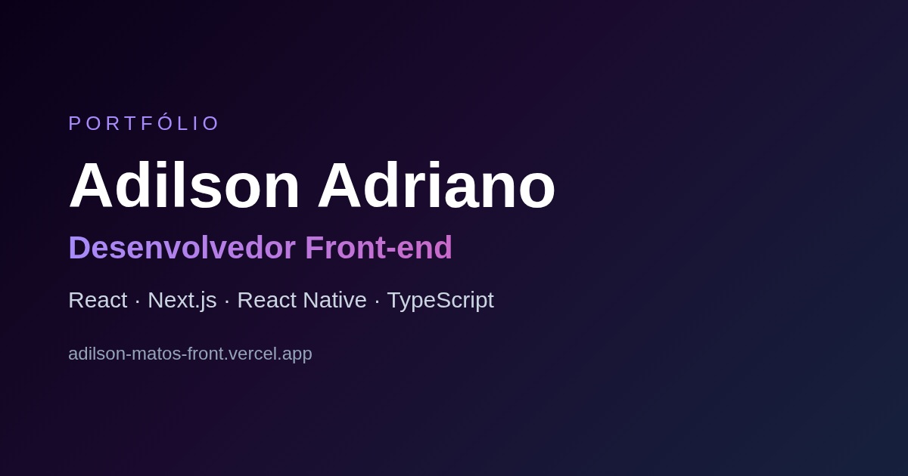
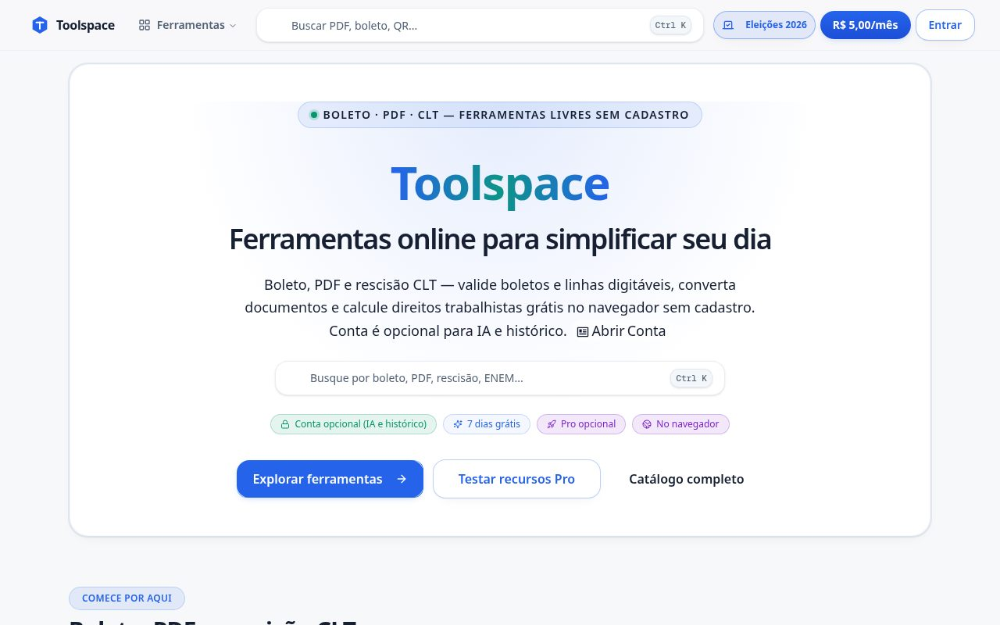

# Portfólio — Adilson Adriano

Portfólio pessoal de desenvolvedor front-end, feito com Next.js, Tailwind CSS e shadcn/ui.

**Site:** https://adilson-matos-front.vercel.app



## Projetos em destaque

| Projeto | Descrição |
| --- | --- |
| [Toolspace](https://www.toolspace.com.br) | Mais de 20 ferramentas online em Next.js na Vercel, com AdSense e pagamento via Mercado Pago e PIX. Cerca de 1.800 visitantes por semana (Vercel Analytics). |
| Valen Rush | Action RPG para navegador em Three.js e TypeScript (repositório privado). |



## Stack

- [Next.js](https://nextjs.org) (App Router) + React 19 + TypeScript
- Tailwind CSS 4 e componentes [shadcn/ui](https://ui.shadcn.com) / Radix UI
- Motion para animações e Three.js / React Three Fiber
- Jest + Testing Library
- Deploy na Vercel

## Como rodar

Pré-requisito: Node.js 20 ou mais recente.

```bash
npm ci
npm run dev      # http://localhost:3000
```

Outros scripts:

```bash
npm run build    # build de produção
npm run start    # serve o build
npm run lint     # ESLint
npm test         # testes com Jest
```

## Estrutura

```
src/
├── app/          # rotas, layout, metadata, sitemap e robots
├── components/   # seções do site (Hero, Projects, Timeline, Contact...)
│   └── ui/       # componentes de interface reutilizáveis
└── lib/          # utilitários
public/           # imagens, prints dos projetos e imagem OpenGraph
```

## Contato

- LinkedIn: [adilson-adriano-062018197](https://www.linkedin.com/in/adilson-adriano-062018197)
- E-mail: nunojraa3@gmail.com
